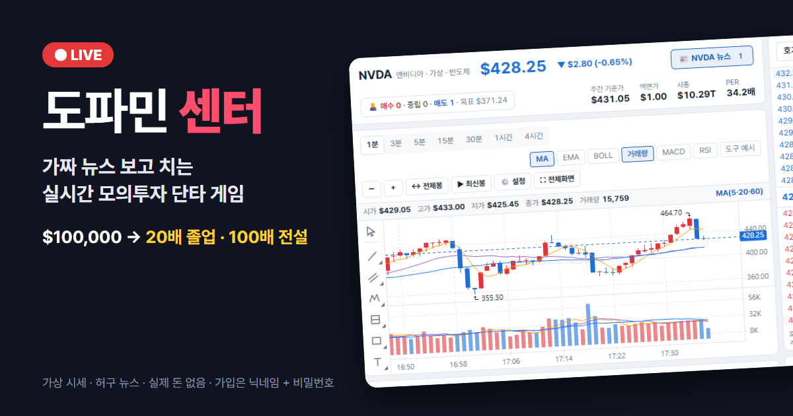
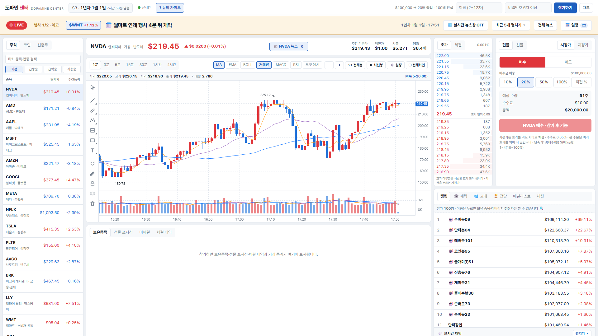
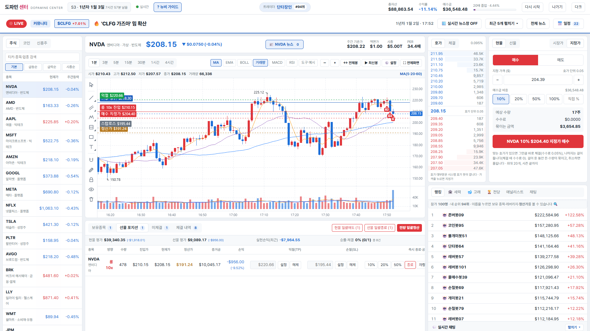
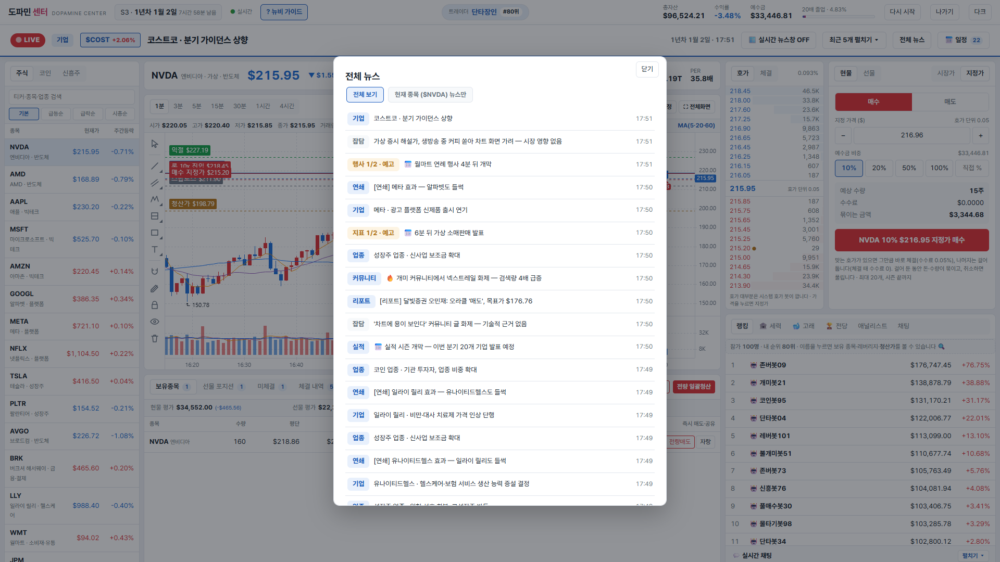
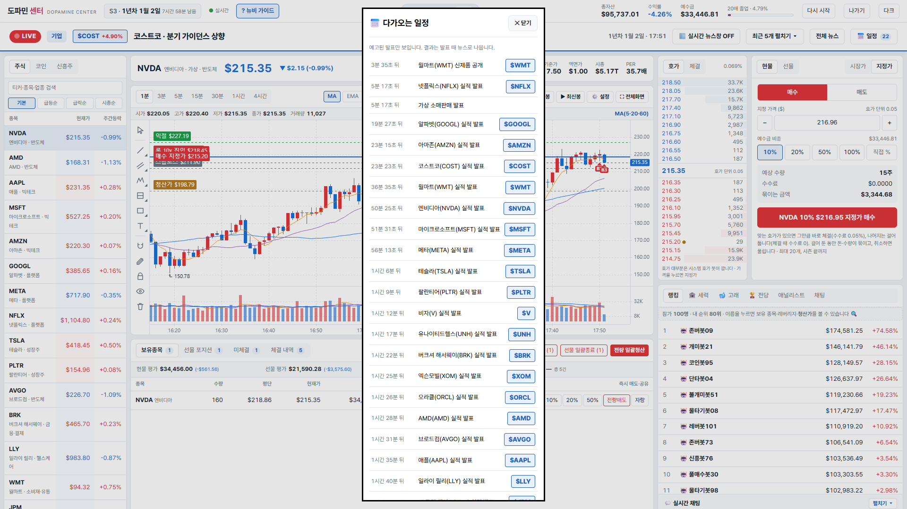
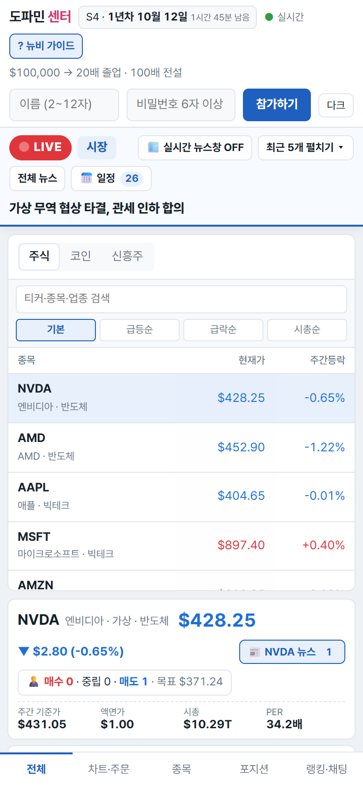

# 도파민 센터 (Dopamine Center)



**내 돈 말고 가상자산으로, 주식·코인 단타의 도파민만 느끼는 실시간 다인원 모의투자 게임.**

$100,000로 시작해 50배면 **졸업**, 100배면 **전설**. 서버가 만든 가짜 뉴스를 읽고, 진짜처럼 움직이는 호가창에서 다른 사람·봇·세력과 같은 가격으로 사고판다.

- 플레이: **https://desktop-f349cdk.tail24dad6.ts.net** (운영자 PC가 켜져 있을 때만 열린다)
- 가입: 닉네임 + 비밀번호만. 이메일·전화번호를 받지 않는다.
- 모든 시세·뉴스·실적·애널리스트는 게임용 허구다. 현금화·결제·실제 자산 연동은 없고, 투자 권유가 아니다.

---

## 스크린샷

**메인 화면**: 종목 리스트, 차트, 호가창 10단계, 주문 패널, 랭킹이 한 화면에 있다.



**거래 중**: NVDA 10배 롱. 차트에 진입가·청산가·익절·손절·걸어 둔 지정가 선과 내 체결(B/S)이 표시된다.



**전체 뉴스**: 시장·업종·기업·연쇄·루머·애널리스트 리포트·예고된 지표와 행사.



**다가오는 일정**: 실적·지표·행사 발표 시각이 미리 보인다. 결과는 발표 때 나온다.



<details>
<summary><b>모바일</b></summary>



</details>

---

## 목차

1. [어떤 게임인가](#어떤-게임인가)
2. [게임 규칙](#게임-규칙)
3. [종목](#종목)
4. [뉴스와 일정](#뉴스와-일정)
5. [같이 노는 것들: 봇·세력·고래](#같이-노는-것들-봇세력고래)
6. [채팅과 소셜](#채팅과-소셜)
7. [화면과 단축키](#화면과-단축키)
8. [기술 구조](#기술-구조)
9. [개발](#개발)
10. [운영](#운영)
11. [문서](#문서)

---

## 어떤 게임인가

| | |
|---|---|
| 목표 | 시즌 안에 $100,000 → $500만(50배, 졸업) → $1,000만(100배, 전설) |
| 시즌 | 매일 00:00~23:58 (2분 쉬고 다음 시즌). 시즌마다 모든 종목이 같은 시작가로 돌아가고, 경로(seed)는 매번 새로 뽑는다 |
| 핵심 재미 | 가짜 뉴스 → 가격 반응 → 단타. 선물 10배와 강제 청산 |
| 체결 | 종목마다 진짜 호가창. 사람·봇·세력의 주문이 모두 같은 호가창에서 체결된다 |
| 보상 | 시즌 끝에 100배 이상이면 명예의 전당과 영구 시즌 엠블럼. 시즌 최종 1~3등은 TOP 3 메달 |

뉴스가 나오면 가격이 반응하지만, 첫 반응 뒤 따라붙는 건 60%뿐이고 나머지는 되돌린다. "뉴스 보고 따라 타기"가 확정 수익이 되지 않게 만든 것이다. 졸업 기준은 50배다 (20배는 너무 쉽게 넘어서 2026-10-23에 올렸다).

## 게임 규칙

### 시간
- 1 tick = 실제 1초. 1분봉 = 실제 1분.
- 게임 하루 = 80초. 등락률은 게임 하루마다 그날 종가 기준으로 다시 잰다.
- 게임 한 달 = 40분. 시즌은 매일 00:00에 시작해 23:58에 끝나고, 2분 쉰 뒤 다음 시즌이 열린다. 쉬는 동안은 거래할 수 없다.
- 시즌마다 1.5~3배의 "우상향" 정도를 하나 뽑는다. 주식은 시즌 동안 대체로 그만큼 오른다.
- 서버가 꺼져 있는 동안은 시세도 멈춘다. 다시 켜면 마지막 tick에서 이어지고, 시즌 끝나는 시각도 그만큼 늦춰진다.

### 계좌
- 시즌 시작 때 예수금 $100,000.
- "다시 시작"을 누르면 $100,000로 리셋. 리셋 뒤 10분 동안은 5배 넘는 레버리지로 새로 진입할 수 없다.

### 주문과 수수료
- **시장가**: 반대편 호가를 좋은 가격부터 먹는다. 큰 주문일수록 더 밀린다. 수수료 0.05%.
- **지정가**: 바로 맞는 호가가 있으면 그만큼 체결하고(수수료 0.05%), 나머지는 호가창에 건다. 걸어 둔 주문이 체결되면 수수료 0.
  - 걸어 둔 동안 필요한 돈이나 수량은 묶이고, 취소하면 풀린다.
  - 1인 최대 20개, 시즌 끝까지 유효.
- 주문·취소는 계정당 1초에 2건까지.
- 현물 매수는 예수금 비율(10/20/50/100%, 직접 입력), 매도는 보유 수량 비율로 주문한다.
- 수량 단위: 주식·신흥주 1주, 코인 0.000001개.
- 한 종목을 얼마나 들든 제한은 없다. 크게 살수록 호가를 먹어 비싸진다.

### 선물
- 롱·숏, 격리 증거금, 레버리지 2·3·5·10배 (주식·코인·신흥주 모두 최대 10배).
- 증거금 손실 90%에서 강제 청산. 자동 보충·펀딩비 없음.
- 스탑로스·익절, 분할 종료(10/20/50/100%), 같은 종목·방향·배율이면 물타기로 합쳐진다.
- 강제 청산 매도가 다시 가격을 밀어 다음 청산이 이어질 수 있다 (연쇄 청산).

### 신흥주
- 가상 기업 10개. 3단계 검증 사건(임상·시제품·인증 같은 것)으로 크게 움직인다.
- 검증에 두 번 넘게 성공하고 시총 $30억을 넘기면 주식 탭 "신성장" 업종으로 **승격**.
- 시총 $5천만 아래면 관리종목. 40분 안에 회복하지 못하면 **상장폐지**되고 마지막 가격으로 정산된다. 유예 중 인수 제안·유상증자 같은 회생 이벤트가 생길 수 있다.
- 가격이 $0.10 아래로 내려가면 주식병합(10:1). 보유 수량·평단·차트·그려 둔 선이 모두 같은 배수로 옮겨진다.

### 랭킹과 명예의 전당
- 랭킹은 총자산 수익률 순. 같으면 100배를 먼저 찍은 사람이 위.
- 50배 "졸업", 100배 "전설" 배지와 전광판 알림.
- 전설은 100배를 **유지하는 동안만** 전설이다. 내려가면 풀리고, 다시 오르면 다시 전설.
- 시즌 끝에 100배 이상인 사람만 명예의 전당에 오른다. 시즌 엠블럼(S1 🔥, S2 💎, S3 🚀, S4 🌙 …)은 영구로 이름 옆에 붙는다.
- 봇은 랭킹에 🤖로 보이지만 명예의 전당·졸업 알림에서는 빠진다.

## 종목

| 구분 | 종목 |
|---|---|
| 미국 주식 20종 (실제 티커, 가상 시세) | NVDA · AMD · AVGO · AAPL · MSFT · AMZN · ORCL · BRK · JPM · V · LLY · UNH · WMT · COST · XOM · GOOGL · META · NFLX · TSLA · PLTR |
| 코인 5종 | BTC · ETH · XRP · SOL · DOGE |
| 신흥주 10종 (가상 기업) | LMQ 루미큐 양자, BNXT 바이오넥스, ORBL 오르빗랩, CLFG 셀포지, FUSN 퓨전원, NXRL 넥스트레일, AQGN 아쿠아젠, MDBR 마인드브릿지, SKPT 스카이포트, GRMT 그린미트 |
| 신성장 | 신흥주에서 승격한 종목 (최대 10개). 폐지·승격으로 빈자리는 예비 신흥주가 새로 상장해 채운다 |

실제 티커를 쓰지만 시세·뉴스는 모두 허구다. 실존 인물 이름을 쓰지 않고, 실제 회사에 위법 혐의 뉴스를 만들지 않는다. 시작가·시총·설명은 [`packages/engine/src/catalog.ts`](packages/engine/src/catalog.ts)가 원본이다.

## 뉴스와 일정

시즌 하나에 약 3,700건, 서로 다른 헤드라인 약 1,400개.

| 종류 | 내용 |
|---|---|
| 시장·업종 | 금리·고용·물류, 업종 공통·업종 전용 소식 |
| 기업·코인 | 호재·악재. 악재가 호재보다 크게 움직인다 |
| 연쇄 | 한 종목 뉴스가 관련주(같은 방향)와 경쟁사(반대 방향)로 번진다 |
| 루머 | 나중에 확인되거나 부인된다 |
| 예고 뉴스 | 경제지표·실적·행사·코인 ETF 심사. 발표 시각이 📅 일정에 미리 올라가고, 결과는 발표 때 공개 |
| 실적 시즌 | 게임 분기(2시간)마다 모든 주식이 실적을 발표한다 |
| 애널리스트 | 가상 애널리스트 5명이 리포트를 낸다. 성향이 서로 다르고, 적중률이 공개된다 |

## 같이 노는 것들: 봇·세력·고래

사람이 적어도 시장이 살아 있도록 컴퓨터 참가자가 같은 호가창에서 거래한다. 사람이 들어오면 그 수만큼 봇이 쉰다.

| 참가자 | 하는 일 |
|---|---|
| 🤖 봇 (100명) | 존버·레버 존버·뉴스 추격·신흥주 베팅·랜덤·저점 매수·올인 중 하나를 10~30분마다 다시 뽑는다. $3만 아래로 떨어지면 새 봇으로 바뀐다 |
| 🏦 세력 (세력1~세력20) | 유동성 공급·청산 사냥·쏠림 역이용·모멘텀·역추세·공매도·가치투자 등 20가지 전략을 20~40분마다 갈아탄다. 별도 탭 |
| 🐋 고래 (10마리, $200만씩) | 큰 금액으로 시장·업종을 흔든다. 별도 탭 |
| 거래량 세력 (5개) | 체결·호가·거래량을 채운다. 가격 방향은 거의 건드리지 않는다 |
| 호가 봇 | 화면에 안 보인다. 종목마다 호가창 양쪽에 물량을 깔아 언제든 체결되게 한다 |

## 채팅과 소셜

- 전체 채팅 1채널. 1초에 1건, 200자, 금칙어 필터, 3명이 신고하면 자동으로 숨김.
- 귓속말: `/w 닉네임 내용`, 답장은 `/r 내용`. 귓속말이 오면 알림음이 울린다.
- **포트폴리오 훔쳐보기**: 랭킹·채팅에서 이름을 누르면 그 사람의 보유 종목·레버리지·강제 청산가가 보인다.
- 수익 인증 `[공유]`: 서버가 실제 계좌로 문구를 만들어서 조작할 수 없다.
- 누군가 강제 청산되면 전광판에 뜬다. 처음 누른 한 명만 **티배깅** 또는 **묵념**할 수 있다.

## 화면과 단축키

- 깔끔한 HTS 스타일. 라이트·다크. 상승 빨강, 하락 파랑 (국내 관례).
- 차트: 1분·3분·5분·15분·30분·1시간·4시간, 지표 MA·EMA·BOLL·거래량·MACD·RSI, 그리기 도구 26종(서버에 저장). 내 체결이 차트에 B/S로 표시된다.
- 호가창 10단계(모바일 5단계). 호가를 누르면 그 가격이 지정가에 들어간다.
- 모바일 반응형.
- 단축키: **B** 매수/롱, **S** 매도/숏, **1~4** 비중 10~100%. 보고 있는 종목을 다시 누르면 차트가 최신 봉으로 간다.
- 처음 왔다면 상단 **? 뉴비 가이드**를 먼저 본다.

---

## 기술 구조

```
브라우저 (Vue 3 + KLineChart)
   │  HTTPS: REST + SSE(1초 tick 방송)
   ▼
Tailscale Funnel (고정 주소, TLS)
   │
   ▼
apps/server  Fastify ── GameLoop(1초) ── Broker(계좌·주문·청산·정산) ── BotRunner(봇·세력·고래)
   │                         │
   │                         ▼
   │                  packages/engine  Market(숨은 기준가·뉴스) + Exchange(호가창·체결·캔들)
   ▼
SQLite (node:sqlite, WAL)  계좌·체결·주문 흐름·스냅샷·채팅·명예의 전당
```

| 영역 | 선택 |
|---|---|
| 저장소 | npm workspaces: `packages/engine`, `apps/server`, `apps/web` |
| 언어 | TypeScript 6.x. 서버·엔진은 Node 24 타입 스트리핑으로 빌드 없이 실행 |
| 엔진 | 순수 TS, DOM·Node API 의존 없음. 같은 seed면 같은 경로 (`Math.random()`·`Date.now()`를 직접 쓰지 않는다) |
| 서버 | Fastify, 1초 GameLoop, SSE 방송. `trycloudflare.com` 같은 SSE를 버퍼링하는 프록시에서는 화면이 1초 폴링으로 바꾼다 |
| 화면 | Vue 3 + Vite + Pinia, KLineChart 9.8.12 |
| DB | Node 내장 `node:sqlite`. 네이티브 빌드가 없어 Windows·Docker 그대로 동작 |
| 테스트 | `node --test` (엔진 25개 + 서버 48개), Playwright 실제 브라우저 종단 테스트 |

설계에서 지키는 것:
- **주문 경로는 하나**: 사람·봇·세력 모두 `Broker` → `Exchange`. 봇도 특혜 없이 같은 호가를 먹는다.
- **숨은 상태는 밖으로 안 나간다**: 엔진의 기준가·국면·대기 충격과 호가 봇 재고는 API로 내보내지 않는다. 테스트가 이를 지킨다.
- **재시작해도 시즌이 이어진다**: 엔진·호가창은 10분마다와 끄기 직전에 스냅샷으로 저장하고, 그 뒤 tick별 순매수(`flows`)로 재생한다. 스냅샷을 못 읽으면 시즌 처음부터 같은 seed와 기록된 주문 흐름으로 다시 만든다.
- **보안**: 비밀번호는 scrypt 해시, 참가 시도는 IP당 1분 10회. 운영자 기능은 16자 이상 `ADMIN_KEY`가 있을 때만 켜지고 `timingSafeEqual`로 비교한다. 귓속말 내용은 SSE로 방송하지 않는다. 서버는 `127.0.0.1`에만 열고 터널로만 밖에 나간다.

## 개발

필요한 것: Node 24 이상, Git. (종단 테스트는 Chrome과 playwright-core를 쓴다)

```bash
npm install
npm run dev:server   # 서버 http://127.0.0.1:4810 (--watch)
npm run dev:web      # 화면 http://127.0.0.1:5173 (/api는 4810으로 프록시)
npm run dev:test     # 봇 100 + 세력 20 + 고래 10과 같이 해 보는 테스트 서버 http://127.0.0.1:5183 (DB 따로)
```

| 명령 | 하는 일 |
|---|---|
| `npm test` | 엔진·서버 테스트 (약 10초) |
| `npm run typecheck` | engine·server는 tsc, web은 vue-tsc |
| `npm run check` | 테스트 + 타입체크 + 1일 시뮬레이션 + 종단 테스트 전부 (약 2분) |
| `npm run sim:bots` | 봇 100 + 세력으로 시즌을 여러 seed로 돌려 졸업·전설 비율과 tick 시간을 잰다 |
| `npm run sim` | 엔진만 돌리는 시즌 시뮬레이션 |
| `npm run e2e`, `e2e:m2` … `e2e:m8` | 실제 브라우저 종단 테스트 (참가·매매·선물·채팅·호가창·모바일 등) |
| `npm run loadtest` | 동시 접속·주문 부하 점검 |

```
packages/engine   시세 엔진(market.ts) + 호가창(exchange.ts) + 종목(catalog.ts) + 뉴스 문구(news-templates.ts)
apps/server       index.ts 라우트·GameLoop·SSE, broker.ts 계좌·주문, bots.ts 봇·세력·고래,
                  season.ts 시즌·스냅샷·재생, auth.ts 참가, chat.ts 채팅, db.ts SQLite
apps/web          Vue 화면: stores/market.ts·account.ts, PriceChart·OrderBook·OrderPanel·HoldingsPanel
tools/            deploy.ps1 배포, fresh-start.ts 새로 시작, sim-*.ts 시뮬레이션, e2e-*.cjs 종단 테스트
docs/             지난 설계·작업 기록
```

규칙·수치를 바꿀 때는 [SPEC.md](SPEC.md)부터 고친다. 개발 규칙(문법 제한, 스냅샷 규칙, tick 순서 등)은 [CLAUDE.md](CLAUDE.md).

## 운영

지금은 운영자 PC에서 서버를 켜고, Tailscale Funnel로 고정 주소를 붙인다.

```powershell
start-server.cmd                                                     # 더블클릭으로 켜기 (= deploy.ps1 -SkipPull). 시즌은 이어진다
powershell -ExecutionPolicy Bypass -File tools\deploy.ps1            # 최신 코드 받기 → 빌드 → 서버 재시작
powershell -ExecutionPolicy Bypass -File tools\deploy.ps1 -Stop      # 서버 끄기 (끄기 전 스냅샷·백업)
powershell -ExecutionPolicy Bypass -File tools\deploy.ps1 -Tunnel    # Funnel이 꺼져 있으면 켠다
powershell -ExecutionPolicy Bypass -File tools\deploy.ps1 -NewSeason # 지금 시즌을 끝내고 새 시즌 (원할 때만)
```

- 백업: 켤 때, 시즌이 끝날 때, 하루 1회 자동 (`data/backups`, 최근 20개).
- 클라우드로 옮길 때는 Docker + Caddy 구성이 준비돼 있다 (`Dockerfile`, `docker-compose.yml`, `tools/deploy-oracle.sh`).

자세한 건 [DEPLOY.md](DEPLOY.md).

## 문서

| 문서 | 내용 |
|---|---|
| [SPEC.md](SPEC.md) | 기획 원본: 게임 규칙·수치·엔진·뉴스·API 전체 |
| [DEPLOY.md](DEPLOY.md) | 서버 배포·업데이트·새 시즌·새로 시작·백업·문제 해결 |
| [CLAUDE.md](CLAUDE.md) | 개발 규칙·코드 구조·명령 (AI 작업자와 개발자용) |
| [docs/](docs/) | 지난 설계·작업 기록 (M8 호가창 설계서 등). 참고용 |
